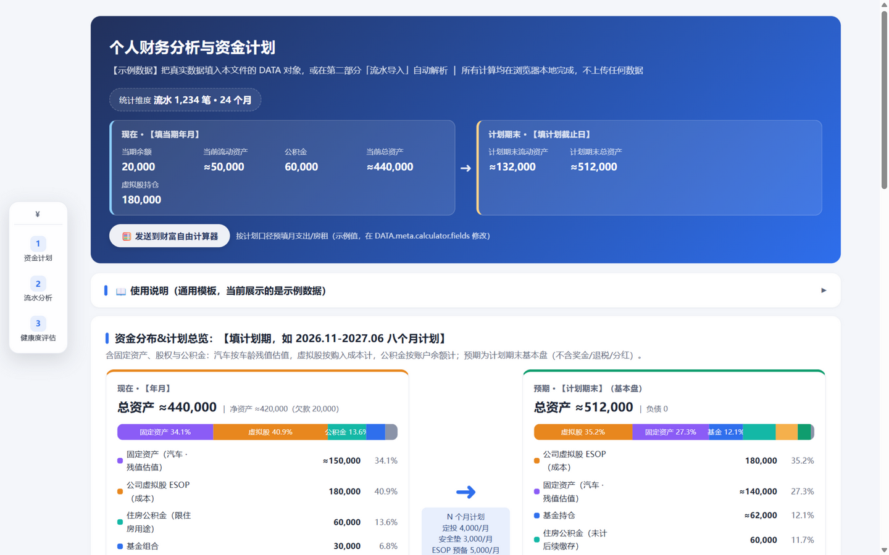
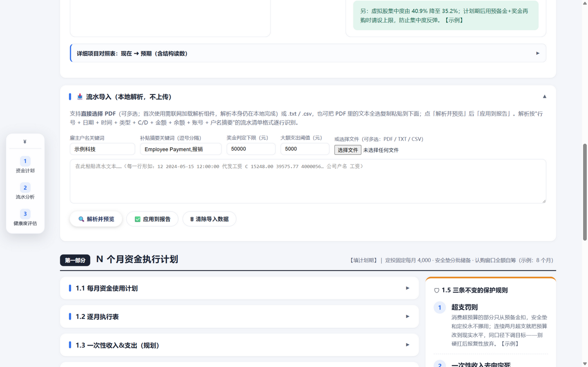
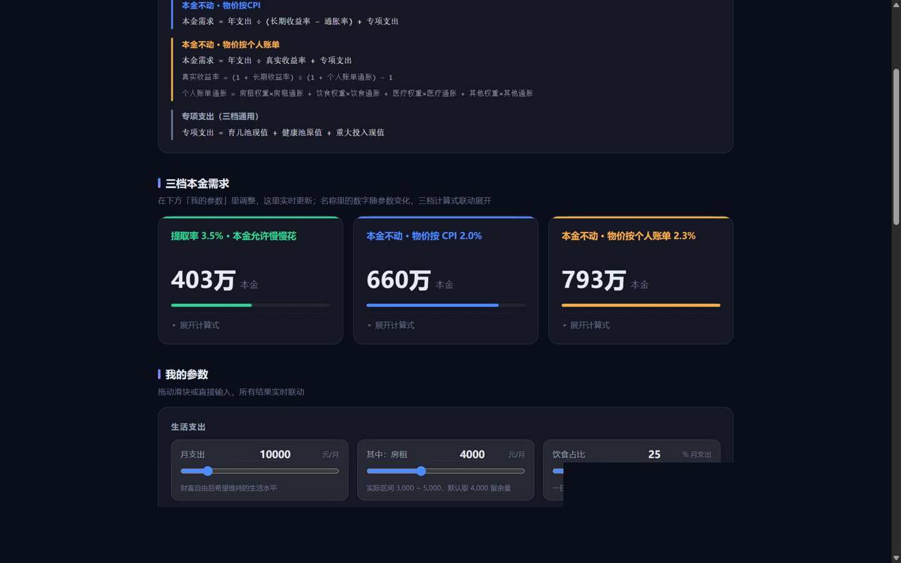

# finance-report-cn · 本地优先的个人财务报告生成器

把银行流水变成一份**完整的个人财务报告**：流水概况、收入结构（含补贴/报销按季度统计）、大额支出、消费画像、资金计划、健康度双口径评估——再加一个财富自由计算器。

**所有计算与解析都在你的浏览器本地完成，不上传任何数据。**



## ✨ 特性

- **📥 流水导入**：直接选择流水 PDF（或 TXT/CSV/复制粘贴），本地逐行解析，自动生成流水分析三节（当前内置交通银行·个人客户交易清单格式，欢迎贡献新格式）
- **💰 资金分布总览**：现在 ➜ 计划期末的双卡对照（含固定资产、股权、公积金等总资产口径），占比条 + 箭头明细
- **📋 8 个月资金计划**：月度四池模板、逐月执行表、一次性收支规划、预期仓位、保护规则
- **🩺 健康度评估**：可投资产口径 + 总资产口径双评分卡
- **🧮 财富自由计算器**：三档模型（提取率/按 CPI/按个人账单通胀），与报告一键联动
- **🔒 隐私设计**：数据只存浏览器 localStorage 与你导出的 JSON 备份；模板文件本身不含任何真实数据

## 🚀 快速开始

**在线使用（推荐）**：打开 GitHub Pages 地址 → `report.html`

1. 打开「📥 流水导入」，选择流水 PDF（首次需联网加载解析组件，解析本身在本地完成）
2. 按 [docs/DATA.md](docs/DATA.md) 填写资产/计划数据——推荐用页面里的「导出/导入我的数据（JSON）」，不改模板文件、升级不丢
3. 点「🧮 发送到财富自由计算器」，把消费口径带入计算器

**本地使用**：`git clone` 本仓库或下载 ZIP，**双击 `report.html` 即可**（file:// 协议完整可用；PDF 导入组件首次加载需联网）。

## 📸 截图

| 流水导入 | 财富自由计算器 |
|---|---|
|  |  |

## 🏦 支持的流水格式

| 格式 | 说明 |
|---|---|
| 交通银行 · 个人客户交易清单 | 内置。其他银行/网银导出格式欢迎按 [docs/IMPORT.md](docs/IMPORT.md) 贡献 |

## 🔒 隐私与安全

- 全部逻辑（解析、统计、评分、计算）在你的浏览器里运行，**没有任何网络请求上报数据**（唯一例外：PDF 解析组件从 CDN 加载一次）
- 导入的流水与填写的数据保存在浏览器 localStorage，可一键清除，也可导出 JSON 备份迁移
- ⚠️ **重要**：填入真实数据后的 `report.html` / 导出的 JSON 备份就是你的隐私文件，**不要提交到仓库或发给别人**。模板本身永远只有示例数据
- 仓库 CI 不扫描内容，请靠自觉 + 善用「导出数据」工作流

## 🛠 开发与贡献

纯原生 HTML/JS，单文件、零构建、零依赖（PDF 解析按需从 CDN 加载）：

```bash
git clone https://github.com/<you>/finance-report-cn.git
# 双击 report.html 即可开发调试
```

欢迎的贡献：
- **新银行流水格式**（最需要！）——见 [docs/IMPORT.md](docs/IMPORT.md)，提交正则 + 脱敏样例即可
- 文档改进、界面样式、新图表
- Bug 反馈请附脱敏样例行（切勿附真实流水）

## English

**finance-report-cn** is a local-first personal finance report generator: import your bank statement (PDF/TXT) or fill in the built-in `DATA` object, and get a full report — cash-flow overview, income structure, large expenses, fund plan, and a two-perspective financial health scorecard — plus a FIRE calculator. Everything runs in your browser; no data ever leaves your machine. See the Chinese docs for details.

## License

[MIT](LICENSE)
